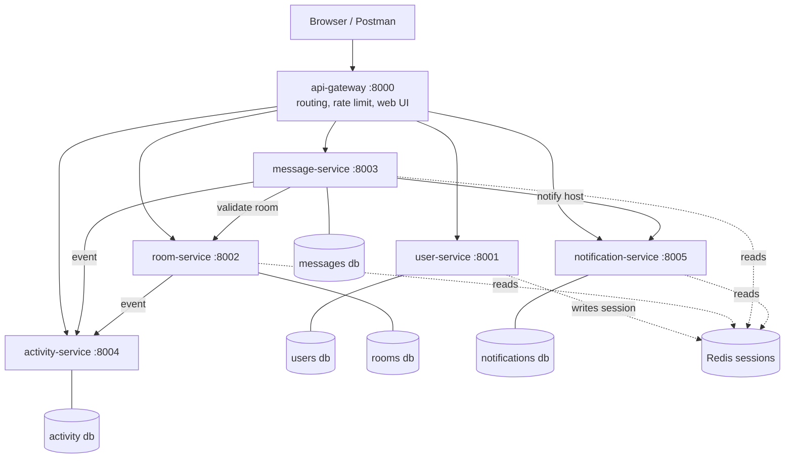

# StudyHub - Microservices Chat Platform

ITS4243 group project. A topic-based chat platform (rooms, messages, notifications, activity feed) built as **6 independent Django microservices** behind an API gateway, each with its own database, plus Redis for shared login sessions.

## Architecture



| Service | Business capability | Port | Database |
|---|---|---|---|
| api-gateway | single entry point, routing, rate limiting, health, web UI | 8000 | none (stateless) |
| user-service | register, login/logout (session), profiles | 8001 | own SQLite |
| room-service | create/search/edit/delete rooms, topics | 8002 | own SQLite |
| message-service | post/list/delete messages | 8003 | own SQLite |
| activity-service | activity feed and statistics | 8004 | own SQLite |
| notification-service | notify a room host when someone posts | 8005 | own SQLite |

How services work together:
- **Auth:** user-service writes the Django session; every service reads it from the shared **Redis** store, so one login works everywhere. The gateway just forwards the cookie.
- **message -> room:** synchronous check that the room exists (503 if room-service is down).
- **message -> notification** and **message/room -> activity:** best-effort calls. If those services are down, posting still works.
- **Internal endpoints** (`POST /notifications`, `POST /events`) need an `X-Internal-Key`; the gateway blocks `/api/activity/events` from outside.
- Older diagram image: `studyhub-docs/architecture.png` (4-service version, being updated).

## Run (Docker)

```bash
docker compose up --build
```
Open http://localhost:8000 for the web UI (register, create a room, post, see notifications, stats and service health). Health of everything: http://localhost:8000/health. Each service is also on its own port (8001-8005) for debugging.

## Test

```bash
# unit tests, one command per service (from the repo root)
cd studyhub-microservices/user-service && python manage.py test
cd ../room-service && python manage.py test
cd ../notification-service && python manage.py test
cd ../gateway && python manage.py test

# end-to-end test (26 checks) against the running system
pip install httpx
python scripts/smoke_test.py
```
Unit tests need `pip install django requests redis`.

## Demo ideas for the viva
1. `docker compose ps`: 6 services + Redis.
2. Register two users in two browsers, create a room, post: the host sees a notification and the activity feed and stats update.
3. `docker compose stop notification-service`, post again: still works, `/health` shows it down.
4. Show the separate databases and the shared Redis session.

## Cloud version (single container)
`studyhub-cloud-version/` is the same app as one Django project (used for the cloud deployment idea).
```bash
cd studyhub-cloud-version
docker build -t simply:latest .
docker run -p 8888:8000 simply:latest
```

## Branching
`main` = stable, `develop` = integration, `feature/<name>` = one per task; merge through pull requests.
