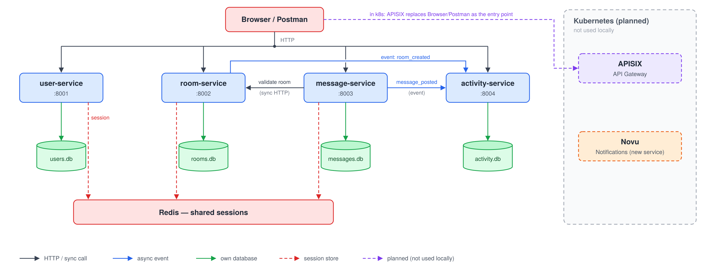

# StudyHub - Microservices Chat Platform

## Architecture



## Compose run

```bash
docker compose up --build
```

- user-service: http://localhost:8001
- room-service: http://localhost:8002
- message-service: http://localhost:8003
- activity-service: http://localhost:8004

## Cloud version run

```bash
cd studyhub-cloud-version
docker build -t simply:latest .
docker run -p 8888:8000 simply:latest
```
Open http://localhost:8888
