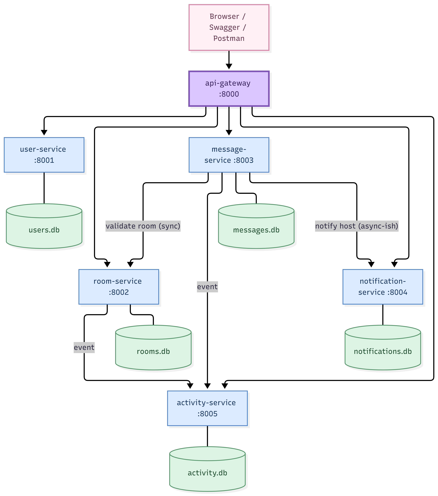

# StudyHub - Microservices Chat Platform

ITS4243 Microservices and Cloud Computing group project. A topic-based chat platform (rooms, messages, notifications, activity feed) split into **6 independently running services**, each with its own database, behind one API gateway.

Evolved from a Django monolith (kept for reference in [`legacy-monolith/`](legacy-monolith)).

## Architecture

```
                    Browser / Swagger / Postman
                               |
                      api-gateway :8000  (routing, health, web UI)
        ______________|________|_________|____________|_______
       |              |        |         |            |
 user-service   room-service  message-service  notification-service  activity-service
    :8001          :8002         :8003             :8004                :8005
   users.db       rooms.db     messages.db    notifications.db        activity.db
                     ^             |  \________________^                  ^
                     |_____________|   (host alert)                       |
                      validate room        events from room + message -----|
```

| Service | Business capability | Port | Database |
|---|---|---|---|
| api-gateway | single entry point, routing, aggregated health, web UI | 8000 | - |
| user-service | register, login (JWT), profiles | 8001 | users.db |
| room-service | create/search/edit/delete rooms, topics | 8002 | rooms.db |
| message-service | post/list/delete messages | 8003 | messages.db |
| notification-service | notify a room host when someone posts | 8004 | notifications.db |
| activity-service | platform activity feed and statistics | 8005 | activity.db |

How services talk (REST over HTTP):
- **message -> room**: synchronous, validates the room exists (503 if room-service is down).
- **message -> notification** and **message/room -> activity**: best-effort side effects. If those services are down, the main action still succeeds (graceful degradation).
- Auth is stateless: user-service issues a JWT, every other service verifies it with the shared secret.
- Internal endpoints (`POST /notifications`, `POST /events`) need an `X-Internal-Key` and are blocked at the gateway.

Details and diagrams: [docs/architecture.md](docs/architecture.md). Team split: [docs/TEAM_TASKS.md](docs/TEAM_TASKS.md).

## Run with Docker (recommended)

```bash
docker compose up --build
```
Open http://localhost:8000 (web UI). Health: http://localhost:8000/health

## Run without Docker

Needs Python 3.10+.

```bash
python -m venv venv
venv\Scripts\activate            # macOS/Linux: source venv/bin/activate
pip install fastapi uvicorn httpx pyjwt
python scripts/run_local.py
```
Each service has Swagger UI at `http://localhost:<port>/docs` (8001-8005).

## Test

With the system running:
```bash
python scripts/smoke_test.py
```
Runs 21 end-to-end checks through the gateway (register, login, rooms, messages, notifications, activity, permissions).

## Demo ideas for the viva
1. Show `docker compose ps`: six containers.
2. Register two users in the UI, create a room, post a message, see the notification and activity feed.
3. `docker compose stop notification-service`, post again: it still works and `/health` shows it `down`. Start it again.
4. Show that each service has its own database volume and own Swagger page.

## Branching
`main` = stable, `develop` = integration, `feature/<name>` = one per service/feature; merge via pull request.
